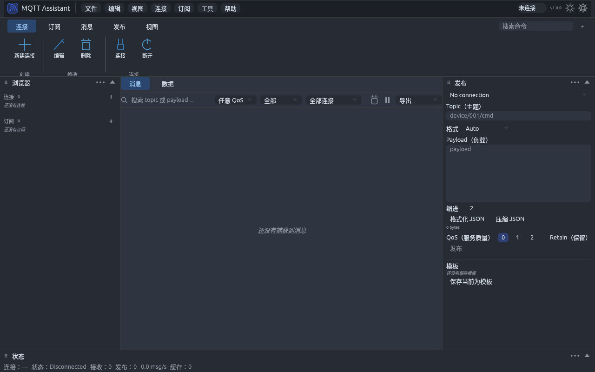

# MQTT Assistant

A native, cross-platform MQTT debugging desktop application written in Rust.

MQTT Assistant connects to brokers, subscribes to topics, watches the traffic live,
inspects every payload byte for byte, and publishes messages with full control over
QoS, retain and MQTT 5.0 properties.



## Interface

The layout follows the desktop CAD applications: an application bar with the
menu bar in it, a ribbon of commands under it, dockable panels around a central
canvas.

- **Application bar** — the application mark and name, the menu bar
  (`文件` / `编辑` / `视图` / `连接` / `订阅` / `工具` / `帮助`), and on the right
  the connection status, the version, the theme switch and the settings.
- **Ribbon** — category tabs (连接 / 订阅 / 消息 / 发布 / 视图) over grouped
  commands, each drawn as an icon with a caption, with the command search on the
  right of the tab strip.
- **Dockable panels** — the browser (connections and subscriptions) on the left,
  the publish panel on the right, the status bar at the bottom, the message
  monitor in the middle. Each panel has a header with a drag grip, an overflow
  menu and a collapse arrow. The browser is a tree: every subscription sits
  under the connection it belongs to.
- **Two pages in the middle** — `消息` shows the captured messages, `数据` shows
  the charts of the data series.

The menu bar and the ribbon speak one vocabulary: every entry produces the same
command, so a command added to one is available in the other.

## Features

- **Connection management** — multiple brokers at the same time, each with its own
  client id, protocol version (MQTT 3.1.1 or 5.0), credentials and TLS settings.
  Passwords live in the operating system keyring, never in the configuration file.
- **Automatic reconnect** with exponential backoff, and a live status indicator per
  connection (Disconnected / Connecting / Connected / Reconnecting / Error).
- **Topic subscriptions** — exact topics, the `+` single-level wildcard and the `#`
  multi-level wildcard, with per-subscription QoS and a default display format.
  A subscription belongs to one connection, and the browser shows it there.
- **Live message monitor** — time, topic, QoS, retain flag, size and a preview for
  every message, plus a detail view with the raw bytes.
- **Payload formats** — Text, HEX (with an offset/ASCII dump), JSON (with an
  expandable tree), Binary, Base64, and Auto detection. A payload is *always* the
  raw bytes it arrived as; every format is only a view of it.
- **Publishing** — Text, HEX, JSON, Base64 and Binary payloads with live validation
  and a byte count, QoS 0/1/2, retain, MQTT 5.0 properties and reusable templates.
- **Data series and charts** — watch one field of the messages of a topic over
  time. The field is a path into the JSON payload (`data.temperature`, arrays as
  `sensors[0].value`), or the whole payload when it is a plain number. Several
  series share one time-series chart, and the series survive a restart.
- **Search and filtering** — by topic, by payload content, by QoS, by retain flag
  and by connection.
- **Export** — captured messages as JSON, CSV, HEX or raw bytes; the binary export
  preserves the original bytes exactly.
- **Light and dark themes**, resizable and collapsible side panels.
- **Chinese and English** — the interface follows the language of the system
  by default, and the language can be pinned in the settings and is
  remembered. The sources are written in Chinese; the other languages live
  in one catalogue in `mqtt-ui/src/i18n.rs`.

## Architecture

The application is a Cargo workspace of five crates with a strict, one-way
dependency chain:

```text
mqtt-app ──▶ mqtt-ui ──▶ mqtt-core
    │           ▲            ▲
    ├──▶ mqtt-engine ───────┘
    └──▶ mqtt-storage ──────┘
```

| Crate | Responsibility |
|---|---|
| `mqtt-core` | Domain model, payload format engine, MQTT topic rules. No GUI, no async runtime, no network library. |
| `mqtt-engine` | The MQTT runtime: one background task per broker, `rumqttc` + Tokio. |
| `mqtt-storage` | SQLite persistence of connections, subscriptions, templates and settings. |
| `mqtt-ui` | The egui panels. It never talks to the engine; it reports intentions. |
| `mqtt-app` | The window, the application state and the wiring between the two. |

The GUI thread never performs network I/O. It sends `MqttCommand`s to the engine and
drains `MqttEvent`s from it; every connection owns a background task that multiplexes
commands and network events.

## Building and running

Requirements: a Rust toolchain (2024 edition, 1.85+) and the usual desktop
dependencies of `egui`/`eframe` (on Debian/Ubuntu: `libxkbcommon-dev`, `libx11-dev`,
  `libwayland-dev`, `libgtk-3-dev`).

```bash
cargo run -p mqtt-app          # start the application
cargo test --workspace         # run the whole test suite
cargo clippy --workspace --all-targets
```

The database is written to the platform configuration directory
(`~/.config/mqtt-assistant` on Linux). Set `MQTT_ASSISTANT_CONFIG_DIR` to use a
different one.

## Testing

The whole project has a single test seam: the engine's command/event channel. The
integration tests start a real broker (`rumqttd`, embedded in the test process) on a
free port and drive the application the way the GUI does — connect, subscribe,
publish, assert on the events that come back.

```text
crates/mqtt-core   unit tests for the format engine and the topic rules
crates/mqtt-engine integration tests against a live broker
crates/mqtt-storage round trips through SQLite
crates/mqtt-ui     headless UI tests: the menus, the ribbon, the browser, the message and data panels
crates/mqtt-app    end to end: state, engine and storage together
```

## Documentation

- [`docs/mqtt.prd`](docs/mqtt.prd) — the product requirements document.
- [`docs/spec.md`](docs/spec.md) — the implementation specification this build follows.

## License

MIT
